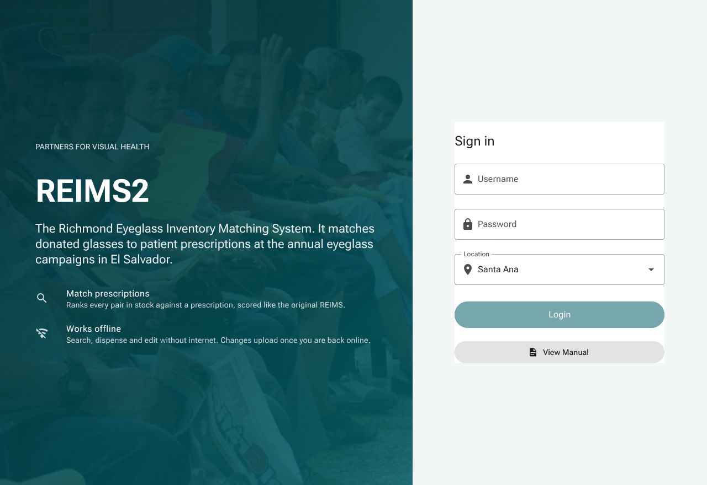
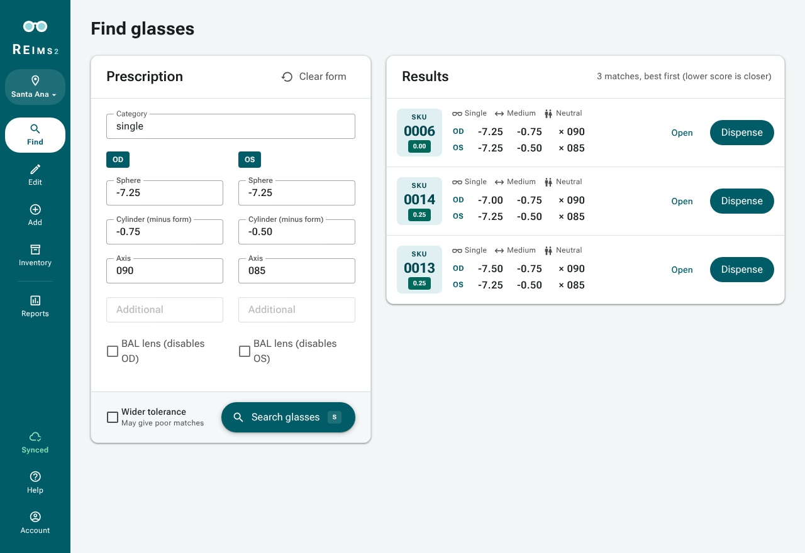
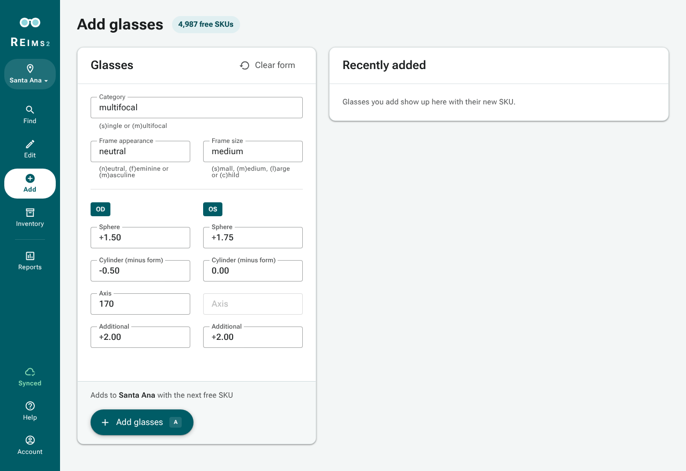
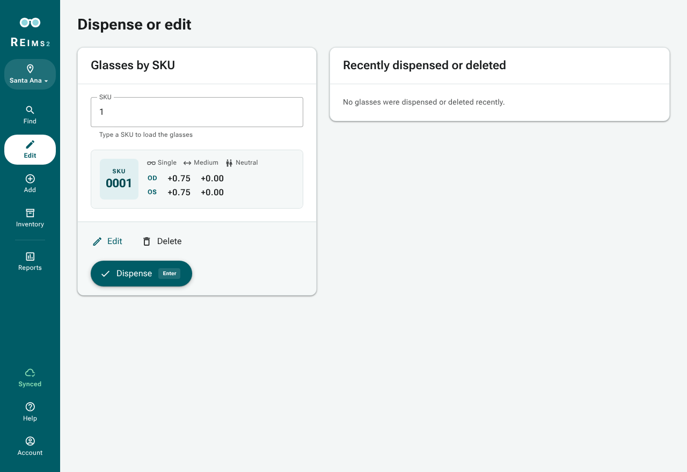
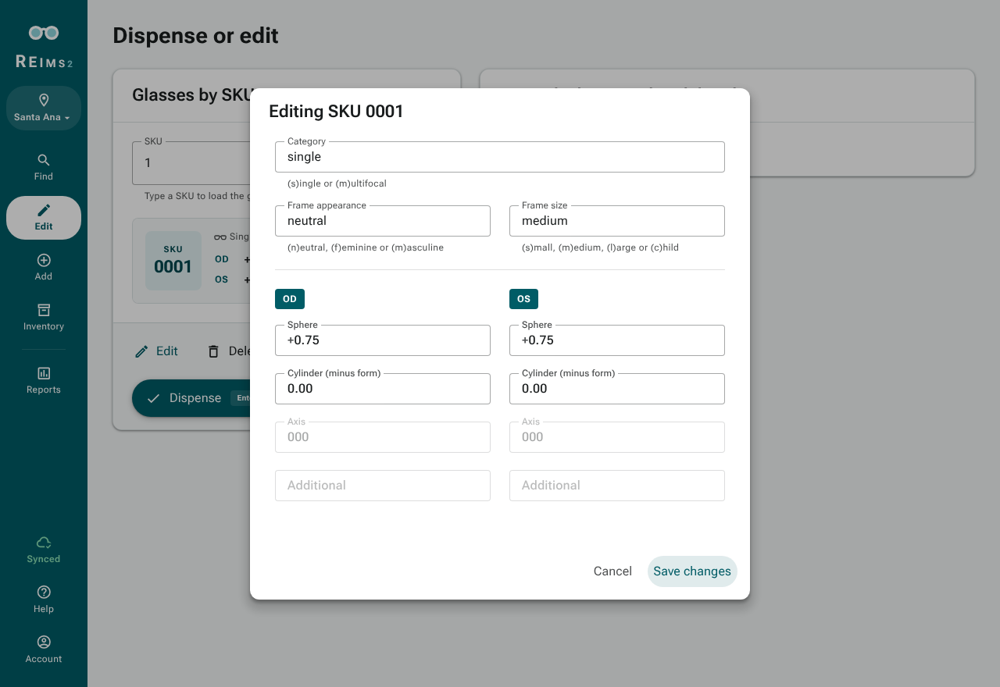
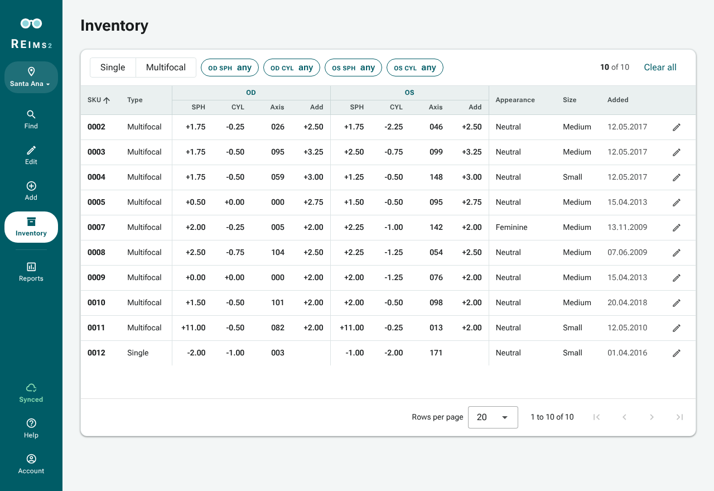
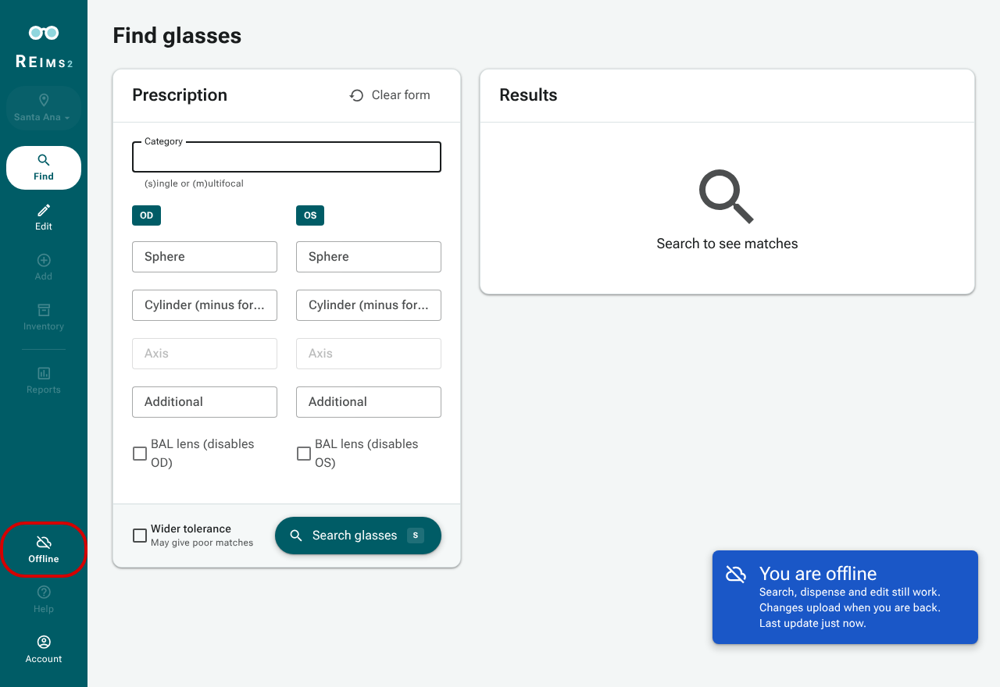

# REIMS2

REIMS2 is the next version of the Richmond Eyeglass Inventory Matching System. It supports the annual visual health campaigns run by non-profit [Partners for Visual Health](https://partnersforvisualhealth.org/). 

This mono-repository contains code for the frontend, backend, documentation, testing and ansible scripts. See their respective README files for a more detailed explanation.

A demo version is available at https://dev.reims2.app

## Screenshots

### Main page

### Searching glasses

### Adding glasses

### Dispensing and editing

### Inventory overview

### Working offline

